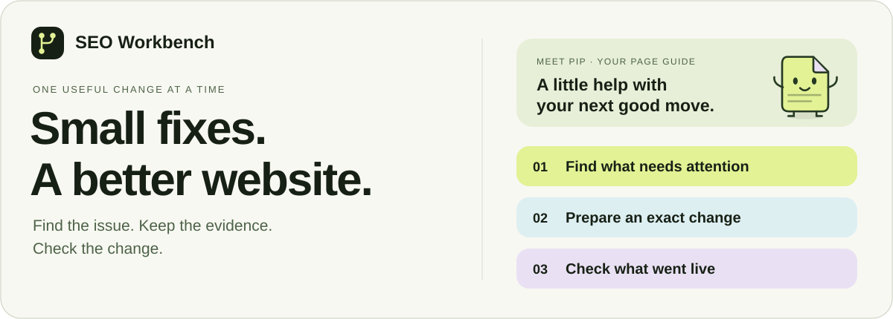
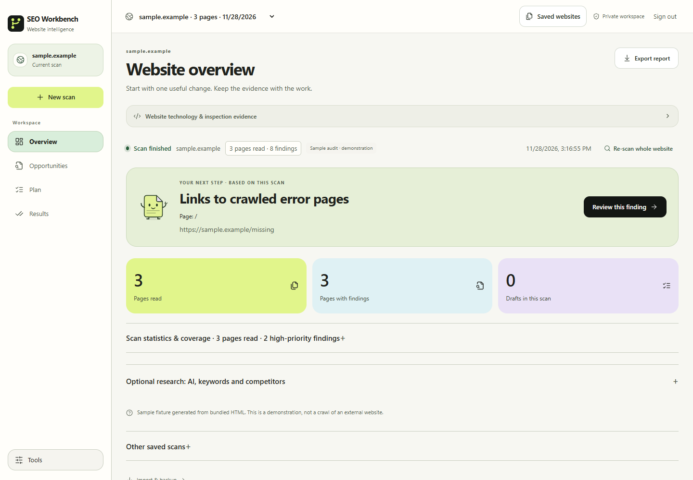
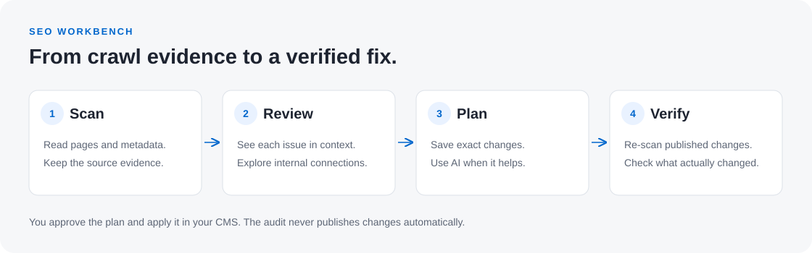

# SEO Workbench



**Turn a website audit into an exact change you can review and check.**

Built for freelance SEOs and developers who can edit a website. Find a problem, inspect the evidence, save a fix, then check the published page. Start without an AI key.

[**Start locally →**](#start-locally) · [Try public speed tools](https://seo-workbench-ten.vercel.app/public.html) · [Open owner workspace](https://seo-workbench-ten.vercel.app)

[](https://github.com/Joy-Ghosh/seoauto/actions/workflows/checks.yml)

## See your next useful move



*Real product screen with bundled demonstration data. The hosted workspace requires the owner's password; public speed tools do not.*

## From finding to finished fix



1. **Find:** scan your site, then inspect a finding, its page and internal links.
2. **Prepare:** save an exact title, description or image-alt draft. Review and approve it.
3. **Check:** apply the edit in your website editor, report publication, then re-scan. See **matches**, **differs** or **could not check**.

Saving a draft does not publish it. A matching response does not prove a ranking improvement.

## Start locally

Use **Node.js 22.14+ or 24.x**, below 25, and npm.

```bash
git clone https://github.com/Joy-Ghosh/seoauto.git
cd seoauto
npm ci
npm run dev
```

Open **[localhost:4317](http://127.0.0.1:4317)** → choose **Explore a sample**, or enter a public website. No workspace password or AI key is needed locally.

| Want to… | Start here |
| --- | --- |
| Use the complete audit → plan → check workflow | Run locally with the commands above |
| Check speed or import Lighthouse JSON | [Public tools](https://seo-workbench-ten.vercel.app/public.html) · no sign-in |
| Use the private hosted workspace | [Owner sign-in](https://seo-workbench-ten.vercel.app) · password required |

## Add more context when you need it

The audit and manual plan work on their own. These extras are optional.

| Need | What you can add |
| --- | --- |
| **Better internal links** | Donor and receiver pages, captured anchors and paragraphs, and incoming/outgoing inspection. Optional local meaning matching compares up to 24 sampled pages. |
| **Search performance** | Import a Search Console **ZIP or CSV**. Keep pages, queries, countries and devices separate; separate exports do not establish page-query relationships. [Guide](docs/SEARCH-CONSOLE.md) |
| **AI suggestions** | Use your NVIDIA key for page improvements, keyword ideas, content briefs and comparisons of supplied competitor pages. Review every suggestion. |
| **Speed evidence** | Request Google PageSpeed data, or import a Lighthouse JSON report without an API key. [Guide](docs/PUBLIC-USAGE.md#getting-speed-metrics-without-a-paid-api) |
| **Page context** | Inspect metadata, headings, image-alt findings, an HTML skeleton and evidence-backed technology hints. |

Local meaning matching uses Transformers.js in a browser worker. It needs no inference API key; the first run downloads model files and uses device memory and bandwidth. It is English-focused and proposes connections, not generated titles. [Details and licenses](THIRD-PARTY.md).

<details>
<summary><strong>Before using AI or Google data</strong></summary>

- NVIDIA receives selected evidence only when you run AI. Its availability, allowance and charges depend on your account.
- Keyword and competitor ideas are hypotheses. There is no live search-volume, difficulty, SERP or backlink feed.
- PageSpeed requests send the chosen URL to Google. Keyless requests can hit quotas; an optional personal key is supported.
- Direct Search Console connection needs your Google OAuth setup. ZIP/CSV import works without it.

[AI and hosted setup](HOSTED.md) · [Search Console setup](docs/SEARCH-CONSOLE.md) · [Cost boundaries](docs/PUBLIC-USAGE.md)

</details>

## Know what the evidence covers

- **Bounded HTML scans:** up to 1,000 pages locally, or 200 with hosted time/evidence limits. Target-site JavaScript is not executed; coverage is not a complete page inventory.
- **Your edits stay reviewable:** publish in your own editor. The optional WordPress companion supports limited fields and requires staging validation. [Publishing boundaries](HOSTED.md#wordpress)
- **Back up your work:** local scans live in `data/`; hosted scans and drafts live in browser storage. There is no shared cloud history or cross-device sync. Export before clearing data.

<details>
<summary><strong>Developer setup, security and project guides</strong></summary>

Production frontend: `npm run build`, then `npm start`. Set `PORT` to use another port.

| Guide | When to read it |
| --- | --- |
| [Contributing](CONTRIBUTING.md) | Setup, code ownership and checks |
| [Hosted deployment](HOSTED.md) | Owner access and Vercel configuration |
| [Security](SECURITY.md) | Credentials, network restrictions and data handling |
| [Interactive project map](https://seo-workbench-ten.vercel.app/project-guide.html) | Understand how the pieces fit together |
| [UX journeys and design system](docs/ux/README.md) | Product intent, user flows and visual rules |
| [Latest UX validation](docs/reviews/2026-11-27/FIRST-USE-AND-PIP.md) | Executed checks and remaining limitations |
| [Roadmap](docs/PHASES.md) | Future work, including ChatGPT MCP |

Built with React, TypeScript, Vite, Node.js, htmlparser2, Zod and browser storage; optional Transformers.js, NVIDIA and Google integrations.

</details>

Found a confusing flow? [Open an issue](https://github.com/Joy-Ghosh/seoauto/issues) with the steps and expected result. Leave out passwords, API keys and private scan exports. Star the repository if you want to follow its progress.
