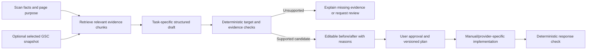

# AI responses: make the recommendations defensible

27 November 2026 · Proposed changes, awaiting approval. No model benchmark or new provider completion was run during this audit.

## Current implementation, verified in source

There is already useful groundwork: task-specific instructions, an SEO quality contract, explicit no-fabrication/prompt-injection guidance, fixed NVIDIA endpoint, bounded requests, cancellation, one formatting-repair attempt, allowlisted repair fields, own-page URL validation, original values taken from the scan and review before publishing. Preserve these.

The remaining gaps are structural:

| Gap | Source evidence | Consequence |
|---|---|---|
| Retrieval depends on crawl order | `server/ai.ts:76–156`: site-wide analysis takes the first 20 deduplicated successful own pages; each packs five short paragraphs, eight links and four images | Important product/page/category evidence can be omitted while less relevant pages consume context |
| Measurement is not in the request contract | `src/ai-types.ts` input and `server/ai.ts` payload have no GSC snapshot | The model cannot responsibly prioritise using imported impressions, clicks or query-page measurements |
| One generic report serves nine jobs | Shared summary/keywords/competitors/actions/sections/repairs schema | Strong prompts still become long prose rather than consistent actionable records |
| Source list is report-level | `parseReport` validates some action URLs, but free-text claims are not linked to exact retained excerpts | A valid source URL does not establish that a generated claim is supported |
| Some promises are prompt-only | Keyword instruction says indexable target; parser accepts a URL in the own-page map without an equivalent eligibility check for that keyword mapping | Prompt compliance is not a deterministic guarantee |
| Link/schema outputs remain largely prose | Link actions can open evidence, but donor/receiver/anchor/context and schema fields are not equivalent typed repair contracts | Hard to validate, deduplicate, plan and check consistently |
| Problem-level generation uses a section heading as fallback | `src/ProblemAssistant.tsx:16–21` finds an English “Proposed replacement” heading and saves the text directly | Alternate wording/locale/extra prose can fail extraction or become the replacement; no editable review field before that save |
| Empty-alt AI handling is inconsistent | Same component requires non-empty replacement text, while the manual workflow can deliberately save an empty alt | A valid decorative-image recommendation has no equivalent generated-save path |
| Claim quality is not benchmarked by transport tests | Tests cover provider behavior, bounded evidence and output restrictions | Passing JSON/schema/security tests does not establish editorial usefulness or factual accuracy |

## Proposed generation pipeline

The model proposes wording and interpretations. Code owns URL eligibility, source lookup, exact anchor occurrence, known field limits, duplicate checks and check outcomes. Do not let a second model vote turn a fabricated fact into a fact.

## Evidence packet

Before generation, assemble a small task-specific packet:

- Website identity, scan ID/date/scope, language and user-confirmed purpose/audience/brand constraints.
- Selected page facts: response, canonical/robots, H1/H2 context, meaningful content sections, current value and related issues.
- Stable evidence IDs for retained excerpts, each with URL, region, timestamp and text offsets/hash. Distinguish raw observation from inferred page type.
- Relevant nearby pages and link occurrences, not the first pages in the crawl. Start with simple lexical/section retrieval; evaluate embeddings as an optional improvement.
- For measurement: only selected property/date/dimension rows, with consent before external sharing. Distinct exports stay distinct; query-to-page mapping requires joint observations.
- For competitor comparison: user-supplied/fetched page evidence and fetch date. Absence in a small sample means “not observed in sample”.

Expose “Evidence used” before running and in each result. Ask a question only when missing context changes the proposed edit; do not force a long setup form for a manual title fix.

## Output contract by job

| Job | Structured output | Required checks |
|---|---|---|
| Title | Target URL, exact current/proposed value, page purpose, short rationale, evidence IDs, unknowns, alternative optional | Known successful own page; no invented features/location/guarantees; duplicate comparison; no rigid character-count quality rule |
| Description | Accurate summary and relevant next step supported by content | No fabricated prices, ratings, availability or service claims; explain that Google can choose another snippet |
| H1 | Proposed heading, observed heading context and intended main-topic relationship | Do not equate multiple H1s with an automatic defect. Advice stays manual until typed plan/check support exists |
| Alt | Exact image identity, user-confirmed meaning or reviewed visual observation, decorative flag, proposed text | Filename is not visual evidence. Empty value valid only with explicit decorative decision. Shared-media scope visible |
| Schema | Schema type, supported property values with evidence IDs, omitted/unknown fields, plain JSON-LD candidate | Parse JSON; validate expected shape and factual support; do not emit placeholders as publishable properties; distinguish Schema.org validity from Google rich-result eligibility |
| Internal link | Donor, receiver, exact anchor, exact source paragraph, existing-link state, editorial reason, insertion vs rewrite | Receiver readable and eligible; exact occurrence exists for insertion; exclude legal/privacy/templates by default; inspect all captured links before calling it new |
| Keyword/topic | Query idea or supplied measured query, intent hypothesis, supporting excerpts, eligible target or new-page hypothesis | No invented demand/difficulty/CPC; measured values belong to a typed provenance field, not generated prose |
| Competitor gap | Competitor/own excerpts, intent comparison, missing-in-sample topic, business relevance, proposed action | No model-knowledge competitor presented as discovered; no inference of competitor traffic, authority or ranking |

Use three separate labels: **Observed evidence**, **Recommendation support**, **Implementation check**. Do not invent a calibrated percentage. “Needs more evidence” is a valid useful result. Blocking unsupported output is preferable to producing a full-looking report.

## GSC use that would actually help

1. Candidate pages: meaningful impressions with unexpectedly low CTR for comparable query/device/country/position context. Fixed cutoffs are screening rules, not proof of a bad title.
2. Query-page alignment: where jointly supplied, compare query intent with the page's current title/headings/content. Do not reconstruct associations from separate Pages.csv and Queries.csv.
3. Content improvement candidates: repeated relevant query clusters with weak current coverage. Distinguish existing impressions from untapped market-size claims.
4. Competing own pages: only propose cannibalisation review when joint query/page evidence supports it; multiple pages for a query can be intentional.
5. Before/after measurement: compatible periods, same filters, annotations for publication and other changes. Show association; do not attribute every change to the edit.

GSC reports concern authorised properties, not competitors. The API can group page and query dimensions, subject to data and row limits; it is not an exhaustive keyword database. [Google query reference](https://developers.google.com/webmaster-tools/v1/searchanalytics/query), [data limitations](https://developers.google.com/webmaster-tools/v1/how-tos/all-your-data).

## Evaluation before choosing a model

Create a proposed 36-case fixture set, six each for title/description, heading, alt, schema, linking and GSC/competitor reasoning. Mix clear, ambiguous, incomplete and malicious evidence: empty title; intentional concise title; branded category; unsupported location; decorative image; missing image description; product without price; partial crawl; legal donor; existing-link alias; noindex receiver; independent query/page exports; prompt-injection text; conflicting baseline.

Automated gates: parseable task schema, valid targets, exact evidence IDs, anchor match, no unsupported fields, correct abstention, no numeric metrics outside supplied typed data, bounded runtime, no credential exposure and no publication tools. Semantic assertions need human review too; regexes cannot prove factuality.

Human rubric: factual support, relevance to the page, intent fit, natural wording, implementation usefulness, appropriate uncertainty and economy. Blindly compare the existing provider with one local candidate using the same packet. Retain unacceptable outputs and rejection reasons. Do not promise a model is better before this comparison. A small accepted case set is not proof of general SEO effectiveness.

Use deterministic fixtures in CI and run actual model comparisons intentionally. Cache evidence extraction/embeddings by content hash; reuse cached generation only when evidence hash, task, user direction, prompt version, provider and model match. Mark reuse and date; do not regenerate on navigation or silently fall back to a paid provider. Keep an explicit refresh action and one bounded repair attempt.

User feedback should capture a reason—unsupported claim, wrong intent, weak wording, duplicate, useful—plus edited text only with consent. Feedback does not automatically train the model. A local evaluation runner or the optional [Promptfoo CLI](https://github.com/promptfoo/promptfoo) can compare fixtures; external model calls or judges still have their own costs.
