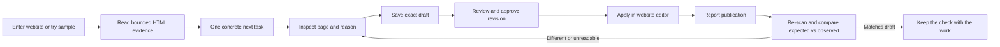

# First-use review, Pip and optional local matching

27 November 2026 · implemented locally; not deployed in this pass.

## Product lens

The primary user is a freelance SEO or a developer improving a site they can edit. Their first useful outcome is one explainable, exact change carried through review and a response check. A business owner needs the same path with less jargon. Multi-client agencies also need ownership, durable history and sharing controls; this private workspace does not yet supply that trust infrastructure.

The desired feeling is: **I know what to do next, why it matters, and what this evidence can actually prove.** Playfulness supports orientation and progress; it must never disguise uncertainty or create pressure to publish.

This is a heuristic review and browser exercise, not interviews, measured usability research or an Apple/Duolingo team review. The sample has deliberately broken pages; it is not a customer success claim.

## First-time eye flow and changes

| Moment | Problem observed | Implemented response |
| --- | --- | --- |
| Arrival | Marketing language, repeated journey cards and optional tools compete with the URL field. | A specific product promise, one scan form, scope explanation below the controls, sample alternative. AI setup is not required. |
| Orientation | The Overview destination was called Websites; compact navigation hid all labels. | Overview matches the screen; narrow left navigation has visible captions and accessible names. |
| Scan | Waiting can feel like a stalled request. | Actual progress and cancellation remain authoritative; Pip briefly looks along the page. No fake percentage or perpetual mascot loop. |
| Results arrive | Counts do not tell a practitioner where to start. | One actual next task appears before the three factual counters, names the affected page, and opens the exact finding or existing plan. |
| Finding | A successful source response can hide failing outgoing destinations. | The direct task action opens the selected finding, destination response and captured anchor evidence. Page evidence and link inspection remain accessible. |
| Group review | Overview filters were applied to the old view context. | Group actions now update the destination Findings context before navigation. |
| Research | Optional AI tools looked like a required next step. | Closed optional-research disclosure. Existing provider consent remains. |
| Saved work | Results duplicated the requested comparison and historical records. | One comparison component, preserved while a requested check completes; saved work remains primary. |
| Internal links | Shared words could suggest policy pages or misleading anchors. | Both matching paths exclude recognised policy slugs, noindex/none and failed responses. Semantic anchors must be exact source substrings with at least two target-topic token matches; otherwise a rewrite is explicitly required. |

### Next-action rule

Resume a reported publication awaiting a check; otherwise open a high-severity finding; otherwise resume an unfinished draft; otherwise open a non-informational finding; otherwise offer the page inventory. This is a transparent workflow rule, not a prediction of commercial impact. Counts and findings are bounded by the scan.

## Pip: character and interaction contract

**Pip** is an original folded-page guide: lime paper, an ink face and outline, a lilac corner and small arms. It uses the existing palette and page/link product metaphor. The working name is not a trademark clearance. It is not a chatbot, an authority on ranking, or a replacement for status text.

| State | Trigger | Behavior |
| --- | --- | --- |
| Welcome | First-use guide | Two short arm waves; three workflow steps open only on request. |
| Reading | An actual scan is running | Two brief eye movements, then a static pose beside real progress. |
| Ready | An actual next task is available | Static guide beside the task; no attention-seeking idle loop. |
| Saved | A draft-save success message | One short nod; this does not imply publication. |
| Checked | A requested comparison has a matching saved result for the current scan | One nod and a small check; no traffic/ranking claim. |
| Error, deletion, credentials | Sensitive or failed operation | No character celebration. Keep actionable text primary. |

The guide can be hidden and restored; preference is browser-local. Keyboard focus moves to the replacement control. SVGs are decorative and hidden from assistive technology. All Pip animation is opt-in through `prefers-reduced-motion: no-preference`; state text remains meaningful without it. No sound, streaks, confetti, or punitive expressions.

## Transformers.js decision

[Transformers.js](https://github.com/huggingface/transformers.js) is used for optional **local semantic internal-link discovery**, not general text generation. The library and selected [Xenova/all-MiniLM-L6-v2 model](https://huggingface.co/Xenova/all-MiniLM-L6-v2) declare Apache-2.0; ONNX Runtime is MIT. See [third-party notes](../../../THIRD-PARTY.md).

- Installed library: `@huggingface/transformers` 4.3.2, exact version in the lockfile.
- Model revision: `751bff37182d3f1213fa05d7196b954e230abad9`; q8, WASM CPU, one thread, browser worker.
- User explicitly allows a model download. No model or runtime requests occur during initial onboarding.
- Up to 24 eligible pages, two bounded paragraphs per page, at most eight proposed connections. English-focused; not validated for other languages.
- Browser inference sends no page text to an inference API. Hugging Face still receives model download requests. Downloads use bandwidth/cache; computation uses the user's CPU/memory. No inference API subscription or shared key is required. Distribution/network costs are not universally zero.
- Source paragraph, donor, receiver, exact anchor or rewrite-needed status and both inspection actions remain visible. Similarity is not a confidence percentage, search volume, competition metric or ranking result.
- Cancellation terminates the worker. Start failure, model error or a 180-second timeout leaves the text-match fallback available. The ordinary crawler does not depend on the model.
- Runtime files are prepared locally by `npm run dev` / `npm run build`. The production CSP permits WASM compilation and specified model hosts without JavaScript `unsafe-eval`. Local production uses the same policy as Vercel.

The production build includes about 41 MB of optional static WASM artifacts (including an additional bundler-emitted variant), plus a roughly 566 KB worker. The main app JS is roughly 207 KB before gzip. These are build artifact sizes, not onboarding transfer totals. Do not market the feature as costless or a tiny dependency.

## Executed checks

- **74/74 tests passed** with host networking. The restricted runner initially blocked three localhost integration tests; the host-network run passed them. No test was removed or skipped.
- **Production build and TypeScript passed.** Existing dependency annotation warnings are nonfatal. No configured lint or coverage threshold.
- **npm audit:** zero reported vulnerabilities at this check; not a security certification.
- Browser: first-use at 390 and 320 px, visible compact nav captions, no horizontal overflow, usable scan controls; guide hide/show focus; exact next-finding action and Escape return; overview problem-group handoff to the correct Findings filter.
- Actual local model inference completed on three eligible practice pages in development and a built production server under the configured CSP; candidate paragraphs and inspection actions rendered. Cancelling a repeat production run retained the previous two candidates. This verifies operation, not recommendation superiority or SEO impact.
- The final optional-match run also returned successfully to text matching. Scan/page changes remount the matching tool so a worker cannot write candidates into another evidence context.
- First-use resource inspection showed no model/worker/runtime request before opt-in.
- Existing test coverage exercises approval invalidation, expected/observed checks, auth, provider restrictions, scan deletion and redirects. This pass did not run real CMS publishing, Google OAuth, NVIDIA generation or a live PageSpeed quota request.
- Pip reduced-motion CSS is guarded and reviewed. OS reduced-motion emulation and screen-reader testing were not performed in this pass; no WCAG certification is claimed.

The active source folder has no Git metadata, so no Git diff or push is claimed. Changed owning modules and the new documentation links were reviewed directly. The temporary production QA server was stopped; the development dashboard remains at http://127.0.0.1:4317.

## Remaining product priorities

1. **Validate the journey with users:** give a freelancer and a site owner one finding, observe whether they reach a saved draft without explanation, and measure confusion before adding more UI.
2. **Evaluate recommendation quality:** maintain a labelled English page-pair set; compare lexical and semantic candidate relevance, existing-anchor precision and rewrite frequency. Local matching is an optional discovery aid until this is measured.
3. **Build trust for client work:** project ownership, durable backups, explicit source/date/coverage and a shareable expected/observed proof record before agency collaboration. Keep ranking/traffic outcomes separate from a value check.

## Design references applied

[Apple feedback guidance](https://developer.apple.com/design/human-interface-guidelines/feedback) and [motion guidance](https://developer.apple.com/design/human-interface-guidelines/motion) informed proximity of status to work and brief, optional, state-related motion. [Duolingo's core-tabs redesign](https://blog.duolingo.com/core-tabs-redesign/) informed stronger hierarchy, consistent labels and review on actual rendered screens. These are interpretations of public guidance, not endorsements or reviews by those teams.
