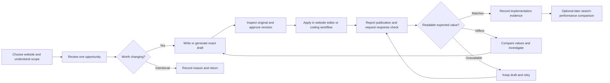

# SEO Workbench: dashboard and recommendation review

27 November 2026 · **Report for approval. No implementation authorised by this report.**

Read [AI quality](AI-QUALITY.md), [free and open-source options](FREE-OPTIONS.md) and [audit evidence/limitations](EVIDENCE.md) for supporting detail. This review builds on the UX foundation, but checks the current implementation rather than assuming those proposals were delivered.

Implementation update: Phase 1 was approved and implemented locally. See [delivery and checks](PHASE-1-DELIVERY.md). The remainder of this report retains its original proposed scope.

## My recommendation

Make the dashboard a place to **choose, finish and explain a useful website change**. Its main job is not displaying every available SEO tool. The current visual direction can work: paper surfaces, pastel cards, green accents and left navigation. The larger problem is how the product directs work and preserves context.

Prioritise three improvements:

1. **One next action, supported by inspectable evidence.** Remove repeated journey navigation and replace the permanent right-hand journey rail with contextual information. Let a person decide what to do without comparing several competing invitations to use AI.
2. **A continuous website → opportunity → plan → result record.** Keep work accessible when another scan opens. Make Results an actual record of checks and unfinished work, rather than starting with an older-scan selection task.
3. **Recommendations validated against source evidence.** Improve content selection, typed outputs, citations and deterministic checks before adding another model. Offer local/open-source inference as an optional delivery choice, not as a substitute for quality controls.

These are design recommendations, not findings from customer interviews. Primary users remain freelance SEOs and vibe coders; business owners follow; agencies require additional ownership, persistence and collaboration work.

## What was examined

Browser walkthrough: the ten current destinations—overview, findings, pages, links, Search Console, title batches, speed, plan, verification and AI—using an existing five-page practice scan and its existing draft. Also examined a page-review drawer and compact layouts. Source inspection covered those surfaces, plan/check contracts, crawl coverage, AI context and response validation, storage/import and deletion boundaries. See [the evidence log](EVIDENCE.md).

No new AI completion, paid API test, site publication, deletion, package installation or Vercel deployment was performed. Loaded Google-data/result variants and active scanning failures were source-reviewed, not all recreated in the browser. This is not an exhaustive accessibility certification or proof of search impact.

## What should stay

- Full-width layout and left navigation, as requested. Keep the new warm sidebar aligned with the content.
- Exact baseline/replacement comparisons, approval, publication reporting, revision invalidation and response checks.
- Inspectable donor/receiver pages, observed anchors and response evidence. These are stronger than a decorative node graph alone.
- Optional AI and Google connections; a manual workflow remains useful without either.
- Explicit separation of missing measurements, unreadable pages and successful checks.
- Trash, separate permanent-deletion confirmation, cancellation and export recovery.

## Prioritised findings

Priority means implementation order: **P1** blocks a core task or can mislead; **P2** adds material friction; **P3** improves polish. Evidence tags: **B** browser observation, **S** source inspection, **H** design hypothesis to test. A hypothesis is not a measured user failure.

| ID | Priority / evidence | Finding and consequence | Proposed change and acceptance |
|---|---|---|---|
| U01 | P1 · B/S | At 320 CSS px, Plan’s “Copy implementation brief”/recheck controls and Search Console upload controls extend past the viewport. Root overflow is clipped, so no scrollbar does not mean all controls are accessible. | Allow action text to wrap and controls to shrink/fill the column. Check actual control bounds at 320/390 px and zoom, including open disclosures. No primary action may be clipped. |
| U02 | P1 · B/S | Opening Results from the original baseline asks for an older scan and can say none exists, despite a checked draft being in that baseline plan. The global destination does not behave like a results history. | Default Results to this website’s recorded checks and drafts needing a check. Keep arbitrary scan comparison as an advanced action. From Plan and Results, open the same revision/expected/observed record. |
| U03 | P1 · S | Drafts are stored by scan ID while scan selection is the main context switch. Another scan can show an empty plan for the same website. Baseline-return links improve the initiated check path, but do not give a durable website work queue. | Introduce website identity and a website-level change index pointing to immutable scan evidence. Migrate without discarding old drafts; show storage location and export. Switching scans must not hide this website’s unfinished work. |
| U04 | P2 · B/S/H | Left navigation, seven audit buttons, centre journey cards and the right journey rail repeat overlapping choices. “Plan with AI” and the rail’s “Make a plan” go to AI, while Plan is a different destination. | Keep one global sidebar. Use page-level filters instead of another tool menu. Make Plan actions open the plan/manual editor; put generation inside the relevant task. A participant should explain the next action without choosing an AI tool first. |
| U05 | P2 · B/S | Websites currently opens the selected scan overview; choosing/managing websites is elsewhere in a selector and modal. The label and destination differ. | Make Websites a searchable list grouped by origin/site, with latest scan, coverage, unfinished changes and Continue work. Give the selected website an Overview destination or context link. Keep each scan separately manageable. |
| U06 | P2 · B/S | Overview repeats counts and introductory guidance in the centre and rail. The constant “next good move” rail remains largely the same on unrelated tasks. | Overview: one scope strip, up to three reasoned next actions and unfinished work. Opportunity detail: evidence rail. Plan: implementation/check context. Empty first use: short explanation. Do not duplicate metrics. |
| U07 | P2 · B/S | The practice page drawer contains multiple routes to AI, technology inspection, all page issues, metadata and an editor. After lazy content loaded, the editor sat around y=2906 in the measured mobile drawer. “Draft this fix” can jump there, but the user still traverses a long mixed task surface. | Open on the selected issue: observation, reason, proposed edit and one next action. Put all page metadata/other issues in secondary views. Preserve the working jump/focus behavior. Keep the editor adjacent to its original value. |
| U08 | P2 · S | Navigating destinations clears query, severity and type filters. Closing a drawer is supported, but navigation does not retain a per-destination working context or an opportunity deep link. | Retain filters and page selection per website/destination. Encode a stable opportunity ID in a deep link when it exists. Back returns to the previous list position/filter; a missing/deleted record gets an explanation. |
| U09 | P2 · B/S/H | Opportunities are still an issue inventory sorted mainly by severity. Editorial checks and observed errors share a similar repeated row presentation. A high count can look like mandatory work. | Provide “Recommended next”, “All findings” and “Reviewed” views. Group recurring template problems; show affected pages, evidence strength and why to review. Keep the raw inventory. Priority must expose its rationale, not an opaque health score. |
| U10 | P2 · S | Page-review work statuses and Plan approval/check statuses are separate systems. “Fix planned” can be selected without a linked draft; a successful value check does not necessarily update that work note. | Link an opportunity to zero or more explicit plan records. Distinguish manual review notes from observed checks; show them together without silently treating notes as verification. |
| U11 | P2 · B/S | Link candidates already show donor, receiver, anchor and context, but cannot become a typed link plan item with a matching check. Users must switch to generic notes/external work. | Preserve the connected cards. Add existing-link checks, exact paragraph/anchor evidence and a Save link proposal state. Only add “verified link” after a verifier can inspect source href/anchor/placement and destination response. |
| U12 | P2 · S/H | Shared-word link matching filters existing links and noindex receivers, but does not establish semantic relevance or exclude legal/privacy boilerplate. Overlap is not editorial confidence. | Add page-type/template exclusions, semantic retrieval and actual source-text checks. Show “existing anchor” versus “rewrite needed”. Keep similarity in advanced detail; never label it probability or SEO impact. |
| U13 | P2 · B/S | GSC is a separate tool panel. Current opportunity thresholds use fixed impression/CTR/position cutoffs; there is no comparable-period analysis or GSC evidence in AI input. | Attach selected measurement snapshots to opportunities. Show property, dates, source and dimension. Use descriptive candidate labels, configurable thresholds and comparisons. No separate-export page/query joins. |
| U14 | P2 · B/S | Speed testing is a separate flow requiring consent/key handling or a manual JSON import. Crawl results and lab results are correctly separate, but the user must organise the relationship. | One optional “Also check performance” choice with explicit device/selected URLs. Initially keep existing PSI/import, then add a local Lighthouse worker. Crawl completion must not wait for or fail with performance testing. |
| U15 | P2 · B/S/H | Site identity is repeated in the sidebar, top context and right rail; platform inspection also precedes tasks where it is not needed. | One persistent website context with favicon, platform evidence state and last scan. Use “Not detected”/“Not checked” accurately. Expand platform evidence when needed for implementation instructions. |
| U16 | P2 · B/S | Scan history is a flat list of attempts. Partial/page-check scans can resemble website projects. | Group scan attempts under the website; visibly distinguish crawl, single-page check and imported evidence. Show requested limit, pages read and why it stopped. “Whole site” remains a bounded discovery attempt. |
| U17 | P2 · S | Storage warnings preserve work in view, but browser-local storage and computer-local scan files are easy to conflate. Backup import restores values without equivalent approval/check history. | Consistent location label and a recovery centre. State exactly what each backup restores; do not imply full workflow-history restoration. Test full storage, import conflict and cross-browser expectations. |
| U18 | P2 · S | Mobile collapses navigation into icons with accessible labels/titles. That preserves space but makes destination meaning less visible to sighted touch users. | Retain left navigation; offer a named expandable left drawer and selected-destination label. Do not introduce the rejected horizontal menu. Keep small-screen task width and visible naming under test. |
| U19 | P3 · B/S | Copy varies between findings, problems, opportunities, repairs, saved changes and plan. Research helper strings also contain replacement characters in source. | Establish a copy dictionary: Finding = observation; Opportunity = reviewed action candidate; Draft = editable change; Plan = saved work; Check = response comparison. Remove encoding defects. Use concrete action verbs. |
| U20 | P3 · S/H | Style has grown through several overlapping stylesheet layers. Current colours now align, but component states and spacing can drift again. | Consolidate shared semantic tokens and components incrementally after task structure is settled. Use the same surface, border, radius, focus, typography and state tokens in navigation, drawers, tables and cards. |

The main owning paths are `src/main.tsx` (navigation, overview, context, drawer), `PageEvidence.tsx`, `PlanPanel.tsx`, `VerificationPanel.tsx`, `repair-plan.ts`, `SearchConsolePanel.tsx`, `search-data.ts`, `LinkOpportunities.tsx`, `server/audit.ts`, `PageSpeedPanel.tsx`, `ScanBackup.tsx` and the shell styles. Reproduction notes and source anchors are in [EVIDENCE.md](EVIDENCE.md).

## Proposed structure and journey

```text
Left sidebar                Selected website workspace
Websites                    Website / last evidence / scope / storage
  Selected website          Overview | Opportunities | Pages | Links
Opportunities               Contextual filters and one primary task
Plan                        Evidence → proposed change → implementation
Results                     Revision → expected/observed → next decision
Tools & settings            Optional research, connections, export/recovery
```

This is a proposed structure, not another global tool bar. Pages/Links are evidence destinations within website/opportunity context. Search data and performance are available from relevant opportunities and the optional tools area. The selected website persists between the four main destinations.



For freelance SEOs, the handoff should be defendable: exact page, original, change, reason, source, ownership and timestamp. For vibe coders, include an editable scoped implementation brief and conflict rule; do not invent a repository location. For owners, default to plain language with platform-specific instructions only when supported. Agency trust later requires persistence, access control and reproducible evidence, not stronger-looking badges.

## What to show, when and why

| Moment | Show first | Primary action | Secondary disclosure |
|---|---|---|---|
| No website | URL, bounded scan scope, privacy/storage explanation | Scan website | Sample and optional connections |
| Scan running | Current phase, pages read/discovered, errors, stop control | Stop scan | Current URL and technical log; no invented percent |
| Returning visit | Unfinished work and latest reliable scope | Continue next change | All scans and imports |
| Opportunity selected | Exact condition, page, evidence excerpt, why review | Draft fix or record intentional | Raw fields, skeleton, links, measurement context |
| Draft generated | Editable original/proposal diff, reason, citations, unknowns | Review and save draft | Alternative wording, model/provider and validation details |
| Plan reviewed | Approved value and implementation location | Copy brief / open documented editor | Provider-specific preview and rollback details when implemented |
| Publication reported | Baseline, revision, expected value | Check page | Other scan comparisons |
| Match/difference/error | Exact outcome and observed value | Return to work / investigate / retry | Raw response timestamp, coverage and constraints |

A decorative illustration belongs in first-use education or an empty workspace. It should not compete with findings, obscure controls or celebrate an unverified change. Colour separates roles; icons and text carry meaning too. Motion acknowledges actual arrival/save/check states; no count-up implying traffic improvement and no perpetual decorative loops.

## UX rules applied where they matter

| Rule | Where and how to apply it | Verification |
|---|---|---|
| Visibility of system status | Crawl, batch generation, import, provider quota and response check have explicit queued/running/partial/failed/complete outcomes | Slow/error/cancel fixtures retain prior evidence; readable status announcements |
| Recognition over recall | Show original/proposed values and selected website where action occurs; retain filters | Complete a handoff without reopening three unrelated screens |
| Progressive disclosure | Default to the current decision; place optional AI, raw evidence and integrations behind relevant controls | Main task remains visible with no connection configured |
| Consistency | One vocabulary and shared component/state tokens | Compare populated, empty, error and mobile versions of each component |
| User control and recovery | Cancel, undo where reversible, preserve unsaved work, explicit publish boundary | Scripted failure/close/retry does not falsely verify or silently discard work |
| Error prevention | Validate targets, versions, evidence and supported field before offering apply/check | Conflicting current value or stale result never overwrites the current revision |
| Accessible interaction | Keyboard order, focus visibility/return, named controls, text/contrast and reflow | Browser tests plus manual keyboard and assistive-technology review |
| Trust and calibrated uncertainty | Observation, recommendation and verification are distinct; measured data has provenance | Participants explain what is known and what is still an inference |

These are contextual rules, not a claim that every design convention should be used everywhere. WCAG 2.2 AA target-size minimum is generally 24 CSS px with exceptions; our primary-action design target is 44 px. Reflow covers 320 CSS px with exceptions for genuinely two-dimensional content. Automated scans alone cannot certify conformance. References: [target size](https://www.w3.org/WAI/WCAG22/Understanding/target-size-minimum.html), [reflow](https://www.w3.org/WAI/WCAG22/Understanding/reflow.html), [focus visibility](https://www.w3.org/WAI/WCAG22/Understanding/focus-not-obscured-minimum.html), [status messages](https://www.w3.org/WAI/WCAG22/Understanding/status-messages.html).

## Phased approval and delivery proposal

| Phase | Scope | Acceptance gate |
|---|---|---|
| 1 · Remove core friction | U01/U02/U04/U07/U08/U19: reflow, fewer competing actions, focused review, remembered context, Results continuity and copy | All primary actions usable at 320/390/768/1440 px; a saved supported draft can be found, applied manually and checked without choosing an unrelated baseline; recovery and keyboard paths pass |
| 2 · Preserve work by website | U03/U05/U10/U16/U17: website list, change index, linked review states, migration and recovery | Existing drafts survive migration; website/scan identity remains explicit; no check attaches to the wrong revision/site; export/restore limitations are tested and stated |
| 3 · Improve recommendation quality | Typed task contracts, evidence retrieval, deterministic validators, editable generation and fixed evaluation set | Unsupported claims/targets are blocked; source traces and missing-data outcomes visible; quality benchmark passes before switching models |
| 4 · Add measurement and useful discovery | GSC-backed candidates, compatible periods, semantic links, sampled competitor comparisons | Correct dates/property/dimensions; no fabricated query-page relationship or competitor traffic; link anchor/target checks pass |
| 5 · Optional local capabilities | Opt-in local model and selected-page Lighthouse worker | Tested device requirements, cancellation, limits and truthful fallback; public hosted deployment does not promise access to the user's localhost |
| Later · Live connectors and agencies | Provider-specific publishing/rollback, durable shared storage, permissions and MCP | Owned staging tests, conflict/rollback checks, ownership and cost model; separate approval |

Do not estimate exact hours before choosing the persistence scope and prototype. First approval should cover Phase 1 and its task prototype, not every future feature. Each phase needs a reviewable outcome before further expansion.

## Success criteria and research

Use the existing six-person formative plan: two freelance SEOs, two vibe coders, one owner and one coordinator. These sessions have not happened. Ask them to choose a worthwhile issue, explain evidence, prepare an edit, hand it off and recover from a failed check. Observe completion, help needed, mistaken certainty and loss of context. Record a timing baseline before setting speed targets.

Release gates: participants distinguish saved/reported-published/checked; unknown coverage is not interpreted as a pass; exact target and expected value survive the handoff; no task loses its draft in the scripted recoveries. Search-ranking improvement is not a gate for confirming an implementation.

**Approval requested:** Phase 1 as defined above, retaining the current brand direction and left navigation. No application files were changed during this report pass. Model downloads, API integrations, persistence changes and deployment remain unstarted pending approval.
