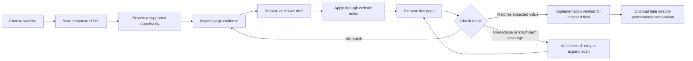
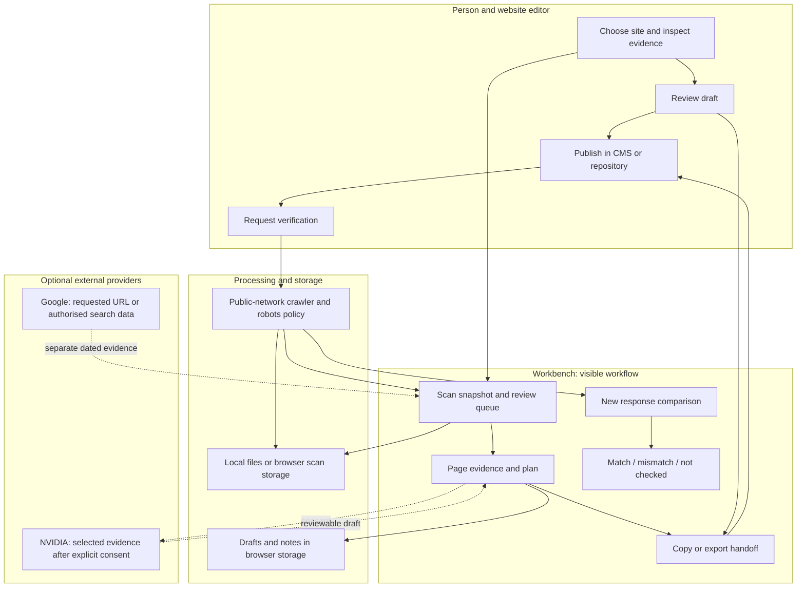

# Journeys and service blueprint

Status: current capability map and proposed experience, 27 November 2026. Emotions, likely friction and user needs below are hypotheses, not observed session results. Proposed states, UI and event records are specifications; they are not all implemented.

## The experience to aim for

“I understand what needs attention, I can choose a sensible next action, and I know what changed.” Confidence should grow through inspectable evidence and control. The interface should feel approachable without rewarding busywork, hiding uncertainty or equating a cleaner audit with better rankings.

## Current journey and the gap to close

| Stage | Current action / data | Source-grounded constraint | Proposed improvement and proof |
| --- | --- | --- | --- |
| Enter | Choose public speed tools, local app or private hosted workspace | These modes have different access, processing and storage; hosted mode is not customer signup | Explain the route by the user's job before asking for optional credentials; person can state which mode they are using |
| Scan | Enter URL/limit; read response HTML | Discovery/HTML coverage is partial; local and hosted caps differ | Keep a stable progress area, readable current state and stop control; show readable pages, discovered URLs and exclusions separately |
| Orient | Browse findings, pages, links or AI tools | Rule severity, lexical suggestions, model drafts and GSC observations are different kinds of evidence | Offer a small review queue with a visible reason and source; user can explain why an item is shown |
| Inspect | Open page review, metadata, skeleton or link evidence | Skeleton is schematic; unscanned destinations remain unknown | Show source, affected element, impact hypothesis and uncertainty in one place; keep raw evidence expandable |
| Draft | Write or ask AI; save supported fields | Persisted `Repair` fields are title, description and alt text; H1/schema/link ideas need another handoff | Show exact current/proposed values and supported destination; no unsupported “save fix” control |
| Publish | Export/copy; use external editor or optional limited WP companion | Core app does not automatically publish arbitrary changes | Provide a field-specific handoff and return checkpoint; label “Apply in your website editor” |
| Verify | Choose baseline/new scan or re-scan a page | Exact draft match and absence of a finding are different; peers/destinations may be uncovered | Show per-check result and required coverage; never roll all results into a blanket success |
| Learn | Optional GSC / speed reports | Imported periods/dimensions and lab conditions constrain interpretation | Separate implementation verification from later performance comparison; label hypotheses and confounders |

## Proposed primary journey

The SEO practitioner needs defensible recommendations and handoffs; the vibe coder needs implementation targets and bounded agent instructions. Do not assume developer expertise or invent source files without access. WordPress/Shopify owners take the editor/handoff branch; agency collaboration stays later.

| Stage | User goal / next action | Show now | State and uncertainty | Expected feeling to test | Acceptance criterion |
| --- | --- | --- | --- | --- | --- |
| Choose website | Start or resume work | URL, site identity, saved work, mode and storage location | No scan yet / saved snapshot | Oriented | Resumes the intended site without starting a duplicate scan |
| Get evidence | Run a bounded scan | Progress text, stop, readable-page count and partial-result access | Queued → scanning → completed/partial/failed | Informed while waiting | Failure preserves the earlier baseline; total site size is not invented |
| Choose one opportunity | Pick a supported next action | Page, observed problem, rationale, evidence type, scope/date and effort band | Needs review; priority is a recommendation | Curious and capable | Can distinguish a measured fact from editorial judgment |
| Review the page | Confirm context | Exact affected element, current value, supporting paragraph, incoming/outgoing links where relevant | Unknowns shown close to the action | Confident enough to decide | Can accept, edit, decline or record an intentional choice |
| Prepare change | Save a reviewed replacement | Before/after, field/location, optional AI sharing consent | Draft; not published | In control | Saved work can be reopened; invalid/unsupported edits explain the next step |
| Apply externally | Publish or hand off | Copy/export, destination instructions and original value | User-reported applied; not verified | Ready to act | User names the editor/owner and knows Workbench did not publish |
| Check live response | Re-scan and compare | Expected vs observed, URL/date/status and coverage | Match / mismatch / not checked | Closure, or a clear recovery path | Match is limited to the checked field/page; unreadable pages never pass |
| Decide next step | Repeat, revise or measure later | Completed implementation record and one next suggestion | Search effect unknown unless analysed separately | Progress without pressure | Can explain what was verified and what remains unknown |

## Service blueprint and trust boundaries

Public-page content and model output are untrusted inputs. Optional provider requests require the appropriate user action/consent. The diagram does not imply new cloud storage or a live publishing connector. WordPress companion behaviour remains field-specific and requires staging validation; it must not be presented as a universal publishing route.

## State model and copy rules

| Proposed user-facing state | What it means | Available next action |
| --- | --- | --- |
| Needs review | A dated scan or analysis surfaced an item | Inspect evidence |
| Draft saved | A proposed value is in the plan | Edit, copy/export or remove draft |
| Applied — awaiting check | User says the editor change is published; this proposed workflow needs a durable record | Re-scan page |
| Matches draft | New readable response matches the expected supported value | Inspect comparison or choose another item |
| Finding no longer observed | That check is absent in the newer covered evidence | Review scope before treating the issue as resolved |
| Does not match | Checked value differs | Compare, check editor/cache and retry |
| Not checked | Data, reachability or coverage is insufficient | Retry or expand coverage; preserve the plan |
| Reviewed intentionally | Person recorded a reason to leave it | Reopen review |

Current states include `matches_draft`, `does_not_match`, `not_checked`, `still_present` and `no_longer_observed`. New workflow states require implementation. Notes are not proof; one-page checks cannot establish site-wide uniqueness or destination health.

## Recovery and alternate journeys

| Situation | Preserve / explain | Useful route |
| --- | --- | --- |
| No AI key or provider failure | Evidence, manual draft and previous research; generation status is separate from scan status | Write replacement manually; retry explicitly if desired |
| No GSC | Crawl evidence still supports technical/content review; search demand unknown | Continue without connection; import later |
| Separate GSC Pages/Queries exports | Dimensions stay separate; no invented query-page pairing | Prioritise at supported dimension; obtain combined data for exact query-page analysis |
| Partial scan / cap reached | Readable evidence and excluded/unread counts | Review covered pages; explicitly expand/re-run within actual environment limits |
| Network/robots/access error | Exact reason and earlier scan; no fabricated zero scores | Retry same scope or inspect site/access; robots exclusions remain respected |
| Browser storage failure | Unsaved status close to work; never claim persistence | Export/copy before leaving; show recovery instructions |
| No publishing access | Draft and original value | Hand off a change brief; return after the owner publishes |
| H1, schema or body-link proposal | Reviewable implementation instructions; no unsupported persisted field | Copy a scoped brief to the page/template editor, then choose appropriate verification |
| Unknown image meaning | Alt attribute and image URL, not invented pixels | Request a description/visual review; decorative status needs confirmation |
| Unscanned link receiver | Candidate destination remains unknown | Inspect/fetch with appropriate scope before recommending implementation |

## Proposed opportunity detail anatomy

1. **Reason to review:** plain observation, page and timestamp.
2. **Confidence in the observation:** source and coverage; separate from confidence in the proposed remedy and unknown SEO outcome.
3. **Exact place:** title/H1/attachment/paragraph/template; distinguish observed placement from an AI rewrite.
4. **Current → proposed:** editable, factual draft; links show donor, receiver and anchor.
5. **Decision:** save supported draft, copy a handoff, dismiss or record an intentional choice.
6. **Return checkpoint:** expected value and the scan needed to check it.

Do not show a fabricated “87% opportunity confidence” or forecast traffic from text overlap. Prefer “Observed in 11 scanned pages,” “AI suggestion — review required,” or “Destination not checked.” Make the source expandable rather than making every card a report.

## Validation before layout implementation

Test [the research tasks](02-personas-and-research.md) with both primary segments. Confirm state comprehension and useful decisions before layout alternatives. Each phase needs a hypothesis, task, scope and continuation gate. Use short save acknowledgements, stable scan status and calm retry feedback; no playful destruction/error treatment.
