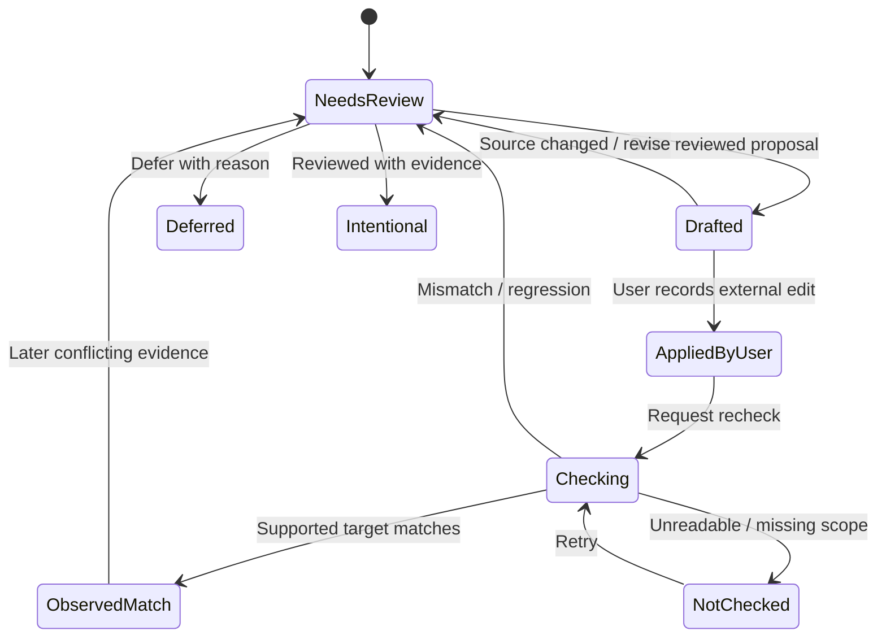

# Opportunity and confidence contract

Status: proposed UX/data contract. This is not yet a new runtime schema or scoring engine.

## Four concepts must stay separate

| Concept | Question | Example |
|---|---|---|
| Finding | What did the check observe? | A successful HTML response has no title |
| Opportunity | Why consider work here? | The page needs a descriptive title; measured impressions may raise its priority |
| Proposal | What might we change? | A reviewed title grounded in visible page content |
| Result | What did a later check show? | New HTML title matches the saved draft at this time |

Verified implementation does not establish ranking or revenue impact. A source page returning 200 does not establish that every outgoing destination is healthy. Short copy, long titles and different canonicals require contextual review.

## Evidence passport

Every opportunity exposes: website/page identity; original scan/report timestamp; exact supporting value or excerpt; collection method (response HTML, imported GSC rows, Google API snapshot, Lighthouse lab report, supplied competitor page, user note); scanned coverage; source filters and date range; rule version where relevant; original/proposed target and unknowns. A click opens the actual evidence rather than a generic explanation.

The header is compact: evidence type + coverage + “Checked [date]”. Expanded details hold method and source. Preserve file/source provenance without exposing credentials or private data in shared exports. Re-importing data must not silently replace the baseline for an active comparison.

## Confidence is not one percentage

Display three separate judgements with explanatory text:

| Dimension | States | Meaning |
|---|---|---|
| Observation | Observed / supplied / not checked | Is this value actually in the retained evidence? An imported report is supplied evidence, not ownership proof. |
| Recommendation support | Supported / needs review / exploratory | Does the proposed action follow from sufficient contextual evidence? |
| Implementation check | Matches expected / still present or differs / not checked | What did a later response or scope-appropriate check show? |

These labels are a proposed rubric, not statistically calibrated probabilities. AI cannot award itself a “verified” badge. Empty evidence cannot become “high confidence” through fluent prose. A reproducible missing-title observation may be strong while the best replacement remains editorially uncertain.

Severity describes the nature of a finding. Priority describes what this user should work on next. Effort and business value are explicitly user-entered or estimated and labelled as such. Neither model fluency nor lexical overlap is SEO impact.

## Queue rules

1. Separate verified response errors/missing fields from editorial heuristics and research ideas.
2. Suppress known irrelevant candidates; group repeated template findings into one task with an affected-page list. Do not lose page evidence or assume a shared root cause just because a title repeats.
3. Offer a short “Start with these” queue with an expandable full audit. Explain ordering; users can change scope, defer or mark intentional with a reason.
4. Prefer observed, actionable issues with clear implementation targets. User-selected business pages can increase relevance, but this choice is not measured commercial value.
5. Use measured demand when available, preserving dimensions. Never interpret missing GSC rows as zero demand.
6. Keep research ideas separate from repair tasks. A queue may contain both, but labels and actions must differ.

Do not release a synthetic impact score until it has a transparent rule, example calculations and evaluation. Initial ordering can be deterministic tiers plus explicit sort controls. Existing fixed CTR/impression thresholds are triage heuristics, not a universal judgement of a bad title.

## Opportunity card anatomy

1. **Change worth considering:** plain-language outcome and page.
2. **Why this appeared:** specific observation and optional measured demand.
3. **Evidence label:** source, timestamp, limited coverage.
4. **Recommended next action:** one clear button, e.g. “Review title”.
5. **Effort and ownership:** unknown until supplied; “Edit in your website editor” when no connector exists.
6. **Inside the task:** original/proposed values, source evidence, limitations, editable rationale, save/defer/intentional, verification plan.

Sample only: “Add a title to /services” / “No title was found in its successful HTML response” / “Observed · HTML scan · [timestamp]” / “Review title”. Do not invent demand, lost clicks or a percentage gain to make the card persuasive.

## GSC + AI workflow

With page-only data: prioritise page review; with query-only data: group themes and flag pages as candidates rather than proven matches. Separate Pages.csv and Queries.csv exports do not establish query→page associations. With combined query/page rows: propose intent/page improvements and investigate multi-page query overlap. Average position is not a fixed live rank; partial data is not the full property.

Compare equal, clearly labelled periods, filters and dimensions before describing a decline. Adjust interpretation for brand, device, country, position, seasonality and sparse data. Never add impressions across overlapping dimensions. CTR targets must be contextual; “potential extra clicks” needs an explicit scenario assumption and is not a forecast.

AI receives only a selected evidence packet after consent: page identity and copy, relevant measured rows/period, observation facts and limitations. Show exactly what will be shared. Deterministic code computes metrics; AI explains possible causes, clusters intent and proposes testable changes. Current runtime does not send GSC rows in its AI input, so this is a planned integration.

Competitor work starts from a relevant own-site query plus user market. Obtain actual SERP/page evidence separately, timestamp it and label market/device where known. Supplied competitor URLs support sampled content comparisons, not competitor traffic, backlink or keyword-volume claims. No automatic paid data subscription is required for the manual-evidence workflow; automation and service quotas remain separate decisions.

## Internal linking task

Show donor and receiver side by side; on mobile stack them in reading order. Present: real page titles/URLs, current donor paragraph, exact proposed anchor highlighted, observed existing links, receiver response/canonical/robots evidence, reason for topical relevance, and source date. Buttons open donor/receiver incoming/outgoing evidence.

Exclude legal/privacy/cookie/utility pages by default from editorial link generation. Exclude self-links, known broken/blocked destinations, links already present at the proposed placement, and invalid URLs. Unreadable destinations require a check, not an insertion recommendation. Navigation/footer links and contextual body links have different roles; a high incoming count from navigation does not prove a useful editorial link exists.

Site-wide orphan claims require declared discovery coverage, sitemap/imported URL inventory and crawl reachability reconciliation; the current bounded crawl cannot prove this. Alias/canonical consolidation needs inspection, not automatic deletion.

## Proposed task states and edge cases

“Applied by you” is a user report. “Observed match” is a dated check. Keep both histories. Cross-page duplicate/link checks need the peers/destinations covered; a one-page check can verify a literal title while leaving uniqueness unchecked. Dismissed and intentional work must remain reversible and separate from verified fixes.

## Trust release gates

- Every high-priority recommendation can open its supporting source.
- Every persisted proposal has an implementation target and original value.
- No stale source is overwritten silently; changed originals trigger review.
- No unreadable/uncrawled page is a success; unknown stays unknown.
- AI drafts are editable and publishing is explicit.
- Shareable evidence export states coverage and redacts keys/private notes by default.
- Later agency features require project ownership, access control, durable audit records and validated multi-client isolation before public marketing claims.

Reference: [Google Search Analytics dimensions and limits](https://developers.google.com/webmaster-tools/v1/searchanalytics/query). Product-specific conclusions above come from the [current source inventory](01-current-product-evidence.md), not from this external reference.
