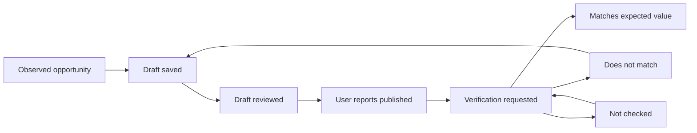

# Information architecture, screen contracts and UX writing

Status: proposed UX specification, 27 November 2026. This document describes the next product structure; it is not a claim that these screens or states are implemented. It is grounded in the existing React application inspected in the earlier Codex workspace. The user selected freelance SEO practitioners and vibe coders as the first audience; their demand and behavioural assumptions still require research. WordPress/Shopify owners are secondary; multi-client agencies come later.

## One job for the product

Help a practitioner choose one worthwhile website change, prepare it accurately, and check the published page. The first decision is **which page deserves attention**, rather than which AI task to run.

The current navigation is Start / Website audit / AI tools / Saved changes, with audit subviews for pages, links, Search Console, verification, titles and speed. The proposed navigation is:

```text
Websites             Choose a site, inspect coverage, start or repeat a scan
Opportunities        Decide what deserves attention and inspect the evidence
Plan                 Review exact drafts and manage the next changes
Results              Check published changes against their baselines

Website context      Current site, scan date, coverage, evidence sources
Settings             AI connection, optional Google connection, storage and access
Advanced tools       Research briefs, schema drafts, raw reports and bulk actions
```

Keep the selected website persistent across these destinations. Clicking a page or link opens a review panel that returns to the originating opportunity, filters and scroll position. Preserve deep links to a particular opportunity or plan item when the underlying record exists. Missing records explain what happened and return to the website, rather than silently opening another scan.

For practitioners, evidence citations, scope and reproducible checks make a recommendation defendable. For vibe coders, the handoff must be editable and exact: affected URL, field, original value, replacement, known implementation target, constraints and the check to run afterward. Offer **Copy implementation brief** without inventing a repository path or promising that an AI coding agent has applied it. Agency trust later depends on durable provenance and verification records, not stronger-looking confidence badges.

## Screen contracts: what, when and why

| Screen | When it appears | Show first | Primary action | Disclosure / prerequisite |
| --- | --- | --- | --- | --- |
| Websites | First visit or site switch | Site identity, latest scan, saved work and storage location | **Scan a website** or **Continue work** | Optional connections follow the first useful result; no API key needed to audit |
| Scan progress | Request accepted | Pages read, URLs discovered, current phase, errors and scope | **Stop scan** | Do not compute a completion percentage from discovered URLs: the denominator can grow |
| Opportunities | Evidence is available | Small ordered set of review candidates; reason, affected page and evidence date | **Review opportunity** | Default to actionable findings; expose context-only checks and full tables through filters |
| Page review | A candidate is selected | Original value, exact problem, relevant page text and source | **Draft a fix** | AI is optional. Expose skeleton, incoming/outgoing links and raw fields as secondary evidence |
| Plan | At least one draft exists, or user opens it | Current value → proposed value, review state, implementation location | **Review next draft** | Exports do not publish; unsupported fields remain research notes until persistence exists |
| Apply guidance | User approves a supported draft | Exact value, target page/CMS field and manual instructions | **I’ve published this change** | This is a user statement that enables checking; it does not mark the change verified |
| Results | User requests verification | Expected value, current observed value, check time and coverage | **Re-scan this page** | Choose the baseline explicitly; retain mismatches and unavailable checks |
| Search evidence | User chooses to add measurement | Source, dates, dimensions, loaded coverage and useful patterns | **Import Search Console export** | CSV/ZIP optional. Google sign-in remains a separate configured integration |
| Performance | User investigates a speed concern | URL, device, report time, source and measured scores | **Run a speed test** | URL-sharing consent; own key or import fallback. A lab score is not a ranking score |

Avoid duplicate counts/actions between the centre and rail. On phones, put the current job first. Tables may scroll in labelled regions; the document must not overflow.

## Opportunity cards are decisions, not decoration

Each proposed card needs: a descriptive title; the affected page; the observed condition; why it is worth reviewing; evidence source/date/scope; the proposed next step; and a clear distinction between a measured fact and an editorial suggestion. State effort only when a known implementation path supports it; otherwise say **Implementation needs review**.

Example using fictional demonstration data, not a live customer finding:

> **Give the Services page a clearer search title**  
> Current title: “Services” · observed in response HTML  
> The title does not describe the service shown on the page. Review a more specific alternative.  
> Evidence: last scan · 1 affected page · no search-performance data supplied  
> **Review title** · secondary: View page evidence

Keep evidence completeness, editorial quality and business value separate. Do not show an invented AI confidence percentage. “High impressions” requires actual loaded measurements.

Internal-link opportunities use a connected donor/receiver display: donor paragraph with exact anchor highlighted; receiver title/URL; existing-link check; observed response/indexing signals; and **Inspect donor links** / **Inspect receiver links**. A lexical overlap score belongs in advanced detail, not a “confidence” badge. Legal/privacy text is not a default promotional-link placement. If the source location is absent, request review instead of pretending the insertion is exact.

## State model and writing



These proposed states require durable versioned records: URL, field/image, baseline, original/proposed values and timestamps. Editing a verified draft creates a version needing another check.

| Situation | Exact suggested copy | Next action |
| --- | --- | --- |
| First visit | “Choose a website. We’ll read its public pages and help you decide what to improve.” | **Scan a website** |
| No AI connection | “Write your own draft, or connect AI for a suggestion.” | **Write a draft**; secondary **Connect AI** |
| No GSC | “Add search data to see how these pages perform in Google. You can continue without it.” | **Add search data**; secondary **Continue with scan evidence** |
| Partial scan | “Read 40 pages. More discovered URLs remain outside this scan.” | **Review scanned pages**; secondary **Scan more pages** if available |
| Scan error | “The scan could not continue. Your saved evidence is still here.” | **Retry scan**; expose the actual cause and scope |
| No matching opportunities | “No opportunities match these filters.” | **Clear filters** |
| No findings in subset | “These checks found no issues in the pages read. Other pages and checks may still need review.” | **Review coverage** |
| Draft saved | “Draft saved to your plan. Your website has not changed.” | **View plan** |
| User reports applying | “Ready to check the published page?” | **Verify this change** |
| Value matches | “The page now matches your saved title.” | **View comparison** |
| Value differs | “The page title differs from your draft.” | **Compare values** |
| Unreadable verification | “We could not read this page, so this change is not checked.” | **Retry verification** |
| Storage failure | “We couldn’t save this work in this browser. Export it before leaving.” | **Export backup**; retain the draft in view |

Use a concrete verb and object: Review title, Save draft, Inspect links, Verify change. Avoid “Optimise now”, “Boost SEO”, “All fixed” and “Success” without an object. Reserve playful colour and small motion for orientation or acknowledgement; use stable, direct language for errors, consent and deletion.

## Implementation boundaries

The existing `Repair` supports title, meta description and image alt text. H1, schema and body/link suggestions can be generated, but they do not yet have equivalent saved repair/verification contracts. MVP copy must not promise they can be managed identically. Search Console data is held separately from the AI context today; “Generate from this evidence” is a proposed integration that needs selected rows, provenance and explicit sharing consent.

Sources: `src/types.ts`, `src/main.tsx`, `src/ProblemAssistant.tsx`, `src/SearchConsolePanel.tsx`, `src/verification.ts` and README. See the [source inventory](01-current-product-evidence.md).
