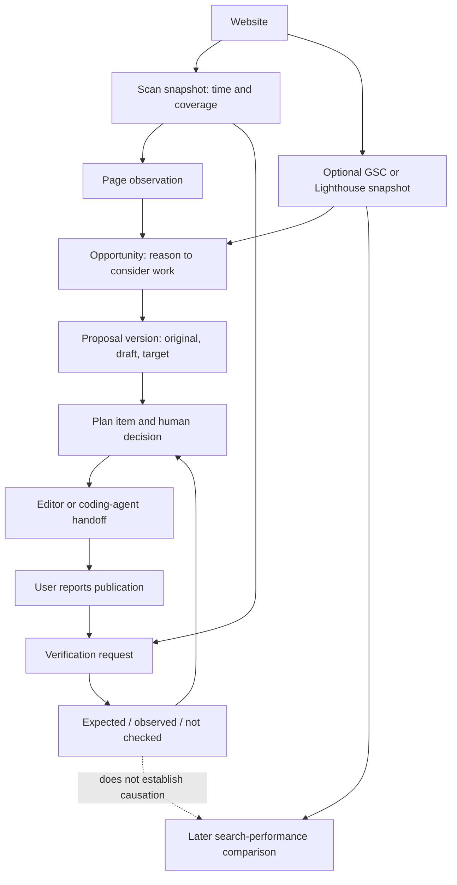
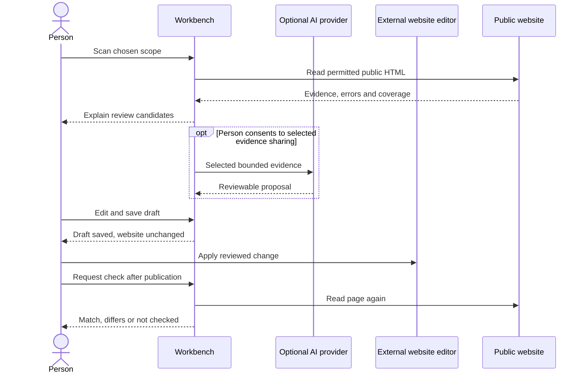

# Traceability and open decisions

Status: proposal. Feature presence comes from [current source evidence](01-current-product-evidence.md); user-need claims are hypotheses except the explicitly selected audience order.

| Need/job hypothesis | Current gap | Proposed screen/component | Phase | Observable acceptance |
|---|---|---|---|---|
| Choose useful work quickly | Tool-led entry, long findings, context-only heuristics mixed with fixes | Opportunity queue + evidence passport | 1 | User explains a selected finding and next action without moderator help |
| Vibe coder knows what to edit | Scan URL is not a known repo/CMS location | Proposal editor + copy implementation brief | 1–2 | Brief includes page/field/current/replacement/check; unknown source path stays unknown |
| SEO can defend recommendation | Overlap or fluent prose can look authoritative | Separate observation/recommendation/verification labels | 1 | User opens source and distinguishes fact from hypothesis |
| Keep work between scans | Drafts keyed to scan/browser; later states are not durable task records | Versioned site-level plan and activity | 2 | New scan does not discard approved original/expected value/history |
| Confirm delivery | Saving and observed absence can be mistaken for fixing | Expected/actual result with coverage | 2 | Unreadable or uncovered page remains not checked |
| Prioritise by demand | GSC stored separately, not in AI request | Selected measurement packet + consent | 3 | Model only sees selected rows/dates and computed metrics match source |
| Find contextual links | Lexical overlap can select brand/legal copy | Connected donor/receiver with relevance and exclusion checks | 1 advice, 2 persistence | Existing anchor/context and target can be inspected; unsafe/irrelevant candidate not recommended |
| Owner needs a safe edit | Platform hint is not a connection | Manual editor guidance, later provider connector | 2 manual, 4 connector | No publish action until supported authorisation/preview/conflict/rollback pass |
| Agency needs credible records | Single-owner/local storage, no collaboration | Dated evidence export now; durable ownership later | 2/5 | Recipient can reproduce scope; client data isolated before collaboration claims |
| Enjoy progress | Counts/motion can imply false SEO wins | Task state feedback and optional workshop illustration | 1–2 | Users know what changed and what remains unverified |

## Proposed product relationship map

This is a conceptual model, not a set of implemented database tables.

## Human and service boundary

## Open decisions and cheapest validation

| Decision | Default for prototype | What would change it |
|---|---|---|
| SEO vs vibe coder entry | Same opportunity flow, progressive Explain/Implementation details | Research shows materially different task order |
| Free product access | Local full app + existing public static tools; no unlimited hosted promise | Tested multi-user/compute model and sustainable funding |
| First supported fields | Title/meta; alt with adequate image context | Typed H1/link/schema plan + verifier proves reliable |
| AI dependency | Optional draft assistance with consent | No reason to block manual work; provider quota cannot be core activation |
| Business value priority | User can name important pages; unknown revenue impact remains unknown | Consent-based measured conversion data and evaluated ranking model |
| Brand character | Optional illustration in education/empty states | Tests show distraction, reduced trust or unclear meaning |
| Agency wedge | Reproducible one-client report/verification handoff | Interview evidence demands collaboration before any useful pilot |

## Trust ladder

1. Explain the observation and let users inspect it.
2. Show why a recommendation follows, including ambiguity.
3. Keep an editable proposal with original and intended target.
4. Preserve who reported implementation and what was independently observed.
5. Make the result reproducible from dated scope and values.
6. Validate access, ownership and cross-client isolation before agency collaboration.

No design claim establishes market adoption. Maintain a decision log after each pilot: hypothesis, evidence, what changed and what remains unknown.
